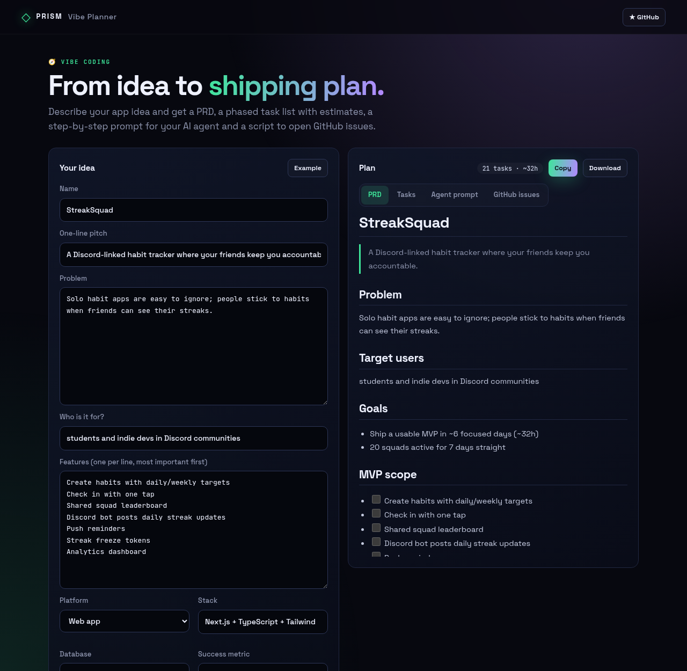
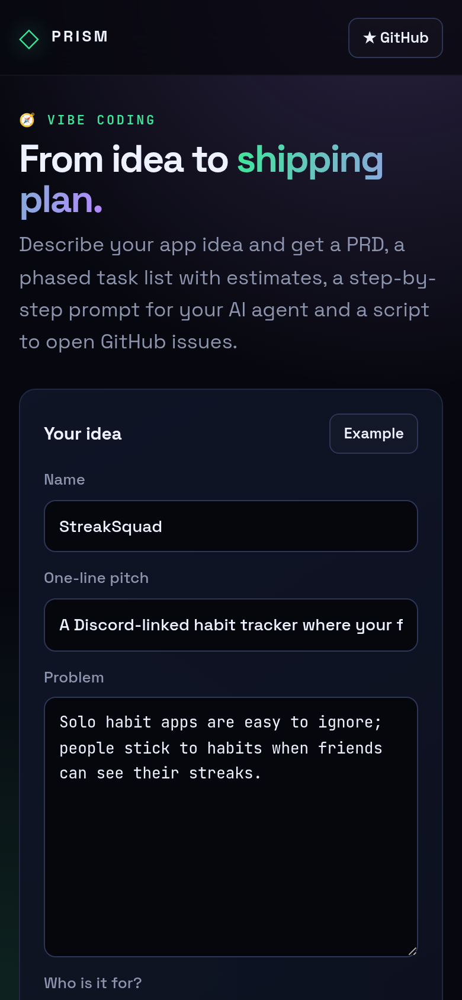

<!-- ═════════════ HEADER ═════════════ -->
<p align="center">
  
</p>

<p align="center">
  
</p>

<p align="center">
  <a href="https://github.com/krishyaa06/prism-vibe-planner/actions/workflows/ci.yml"></a>
  <a href="https://krishyaa06.github.io/prism-vibe-planner/"></a>
  
  
  <a href="LICENSE"></a>
</p>

<p align="center">
  
</p>


## ⚡ Overview

**Prism Vibe Planner** gives vibe coders a plan before the first prompt. Write the name, pitch, problem, users and a list of features in priority order. The planner splits MVP from later work, writes a clean PRD, builds a phased task list (setup → MVP → launch → next) with time estimates, and creates an agent prompt that walks Cursor, Claude Code or Copilot through the tasks one at a time. A generated `gh` script turns the tasks into GitHub issues.

## ✨ Features

- **PRD** with problem, users, goals, MVP scope, out-of-scope, tech and risks
- **Automatic scoping** — top ~60% of features become MVP, the rest go to later
- **Phased tasks** with estimates and a check-off list saved locally
- **Agent prompt** that works through tasks one at a time
- **GitHub issues script** using `gh issue create` with phase labels
- Platform-aware setup tasks: web, mobile, CLI, Discord bot, API

## 📸 Screenshots

<table>
  <tr>
    <td width="68%"></td>
    <td width="32%"></td>
  </tr>
</table>

## 🚀 Quick Start

**Use it online:** [https://krishyaa06.github.io/prism-vibe-planner/](https://krishyaa06.github.io/prism-vibe-planner/)

**Run locally:**

```bash
git clone https://github.com/krishyaa06/prism-vibe-planner.git
cd prism-vibe-planner
# open index.html in your browser, or serve it:
npx serve .
```

## 🛠️ Usage

1. Fill in your idea (or click **Example**). List features most-important-first.
2. Switch between **PRD / Tasks / Agent prompt / GitHub issues**.
3. Copy or download, then paste the agent prompt into your AI tool and ship task by task.

## 📁 Project Structure

```
prism-vibe-planner/
├── assets/
│   ├── logo.png
│   └── logo.svg
├── css/
│   ├── app.css
│   └── prism.css
├── js/
│   ├── app.js   # form + tabs
│   ├── core.js   # planner, exporters, markdown renderer — tested in Node
│   └── prism.js
├── test/
│   └── core.test.js
├── .gitignore
├── LICENSE
├── index.html
└── package.json
```

## 🧪 Tests

```bash
npm test
```

Tests use the built-in `node:test` runner, so there is nothing to install. CI runs them on Node 20 and 22.

## 🤝 Contributing

1. Fork the repo and create a branch: `git checkout -b feature/my-idea`
2. Make your change and add a test in `test/`
3. Run `npm test` and open a Pull Request

## 🔷 Part of Prism Protocol

Prism Vibe Planner is one of the open-source tools built by [Prism Protocol](https://dc.gg/prismprotocol), a tech community where young builders learn, ship and compete together.

## 👤 Author

<table>
  <tr>
    <td align="center">
      <a href="https://github.com/krishyaa06"><br><b>Soumya Bhandare</b></a><br>
      <sub>Founder @ Prism Protocol</sub>
    </td>
    <td>
      <a href="https://dc.gg/prismprotocol"></a><br>
      <a href="https://instagram.com/prism_protocol_"></a><br>
      <a href="https://x.com/krishyaa06"></a>
    </td>
  </tr>
</table>

## 📄 License

Released under the [MIT License](LICENSE).

<p align="center">
  <b>If you like this project, consider giving it a ⭐</b><br>
  <sub>"Build. Create. Compete." · Made with ⚡ by Prism Protocol</sub>
</p>


